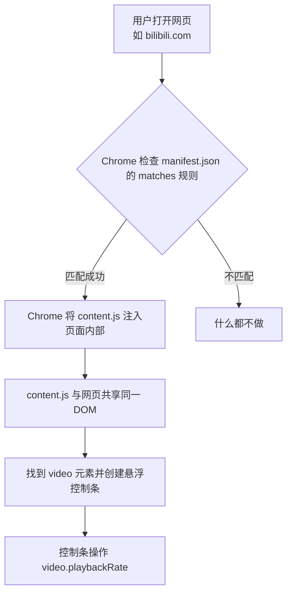
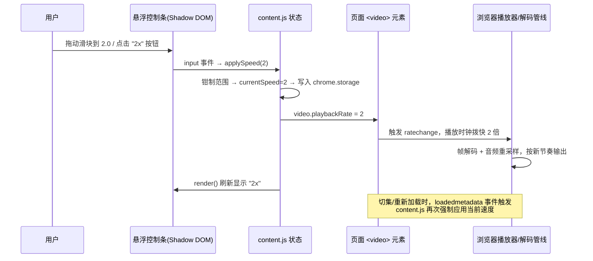
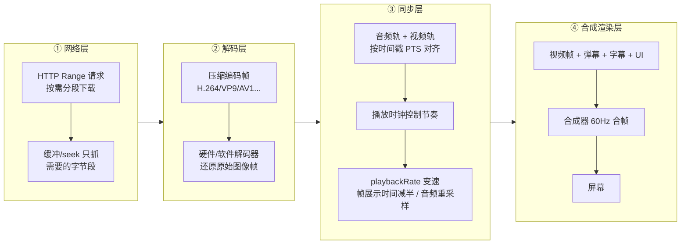

# 视频倍速控制器（Chrome 扩展）

一个可在**任意网页**（B 站、YouTube、本地文件等）上可视化控制 HTML5 视频播放速度的
Chrome 扩展。加载后网页右下角会出现一个可拖拽的悬浮控制条：

- 拖动滑块精确调速（**0.25x ~ 16x**，步进 0.05）
- 一键快捷按钮：`0.5x / 1x / 1.5x / 2x / 2.5x / 3x / 4x / 8x`
- 速度与控件位置**跨页面记忆**（刷新、换页后仍然生效）
- 样式用 **Shadow DOM 完全隔离**，不污染网页、也不被网页样式污染

---

## 一、快速开始（30 秒加载）

1. 打开 Chrome，地址栏输入 `chrome://extensions/` 并回车；
2. 打开右上角 **「开发者模式」** 开关；
3. 点击 **「加载已解压的扩展程序」**，选择本文件夹路径
   `D:\Workspace\video-speed-controller`；
4. 打开任意带视频的网页（如 bilibili.com），右下角即出现悬浮控制条。

> 若要在本地 `file://` 页面（如 `test.html`）生效，需在扩展卡片上点击
> **「详细信息」→ 打开「允许访问文件网址」**。
> 修改代码后：回到 `chrome://extensions/` 点扩展卡片上的 **刷新按钮（↻）** 即可，
> 已打开的网页需刷新一次（content script 会重新注入）。

---

## 二、文件结构

```
video-speed-controller/
├── manifest.json   # MV3 配置文件：声明权限与内容脚本注入规则
├── content.js      # 核心逻辑 + 悬浮控制条 UI（Shadow DOM）
├── test.html       # 本地验证页（无真实视频源也可验证注入）
└── README.md       # 本文档
```

---

## 三、原理讲解

### 3.1 网页视频的速度本质：`playbackRate`

HTML5 的 `<video>` 元素自带播放速率属性 **`playbackRate`**。浏览器的播放器
按这个值决定画面与声音的输出节奏：`1` 正常，`2` 两倍速，`0.5` 半速。

> Chrome 对 JS 可设置的有效范围约 **0.0625 ~ 16**，超出会被自动钳制
> （clamp）到边界。因此本插件把滑块范围设为 `0.25 ~ 16`。

B 站、YouTube 等网站的视频播放器无论 UI 多花哨，底层都是同一个
`<video>` 元素，所以**只要拿到页面上的 video 元素、设置这个属性，
速度就变了**。网站自己的倍速菜单做的也是同一件事，插件只是绕过 UI
直接操作底层属性。

### 3.2 插件如何"进入"网页：content script（内容脚本）

网页代码在服务器上，用户无法直接修改。Chrome 提供 **content script**
机制：由 `manifest.json` 声明匹配规则，Chrome 在用户打开匹配的页面时，
自动把你的脚本**注入页面内部运行**——脚本与网页共享同一个 DOM，
就像在 F12 控制台里敲代码一样。

```json
{
  "content_scripts": [
    {
      "matches": ["<all_urls>", "file:///*"],
      "js": ["content.js"],
      "run_at": "document_idle"
    }
  ]
}
```



### 3.3 一次完整调速的控制链路



### 3.4 关键实现细节

| 机制                   | 作用                                                            | 代码位置                  |
| ---------------------- | --------------------------------------------------------------- | ------------------------- |
| `MutationObserver`     | 视频元素是**异步出现**的，页面 DOM 一变就重新扫描并接管新 video | `startWatching()`         |
| `loadedmetadata` 事件  | 切集 / 换清晰度时播放器可能重置速度，强制再应用一次             | `onMeta()`                |
| `ratechange` 事件      | 网站自身改速度（如 B 站倍速菜单）时，同步 UI 保持一致           | `onRate()`                |
| `applying` 标志        | 区分"我们自己改的"与"外部改的"，防止事件回环死循环              | `applySpeed()`            |
| `Shadow DOM`           | 控件样式完全隔离，不污染网页、也不被网页 CSS 影响               | `buildUI()`               |
| `chrome.storage.local` | 速度与控件位置跨页面、跨站点记忆                                | `loadSaved()/saveSpeed()` |

### 3.5 浏览器播放视频的完整管线（背景知识）



**关键理解**：`<video>` 对网页是"黑盒"——网页只能通过有限的 API
（`play()`、`pause()`、`playbackRate`、`currentTime` 等）控制它。
**`playbackRate` 就是浏览器留给网页的唯一"变速旋钮"**，本插件控制的
正是这个旋钮。

---

## 四、自动验证方式（可选）

项目自带 `test.html`：页面脚本先把速度设为 `3`，插件注入后会接管为
记忆中的速度（默认 `1`），并把结果写到悬浮控制条根元素的
`data-speed` / `data-video-rate` 属性上。

**验证方式 A —— 手动加载（推荐，即用户实际使用方式）**

1. `chrome://extensions/` → 打开「开发者模式」→「加载已解压的扩展程序」
   选择本项目文件夹；
2. 若用 `file://` 打开 `test.html`，需先开启扩展的「允许访问文件网址」；
3. 打开 `test.html`，右下角出现悬浮控制条即注入成功；
   刷新页面并观察速度标签从 `3x` 变回 `1x`（说明插件已接管）。

> 注意：Google Chrome **正式版不允许**通过命令行 `--load-extension` 加载
> 未打包扩展（安全限制，日志报 `--load-extension is not allowed in Google
> Chrome, ignoring`），该参数仅对 Chrome for Testing / Chromium / 开发版
> 有效。因此自动化验证采用下面的方式 B。

**验证方式 B —— 逻辑 harness + CDP 自动化（本项目开发时采用）**

把 `content.js` 作为普通脚本注入测试页（stub 掉 `chrome.storage`），用
Chrome DevTools Protocol 在真实渲染引擎中验证。已通过的自动化用例：

| 用例                                            | 结果 |
| ----------------------------------------------- | ---- |
| 控件注入（滑块 / 8 个预设按钮 / 收起按钮）      | ✅    |
| 接管速度（页面初始 `3` → 插件改为记忆速度 `1`） | ✅    |
| 点击 `2x` 按钮 → `video.playbackRate === 2`     | ✅    |
| 滑块拖到 `4.5` → `playbackRate === 4.5`         | ✅    |
| 外部改速 `1.25` → UI 同步显示 `1.25x`           | ✅    |
| 超范围钳制：设 `100` → 实际 `16`（Chrome 上限） | ✅    |
| 收起 / 展开                                     | ✅    |
| 动态新增 `<video>` 被 MutationObserver 接管     | ✅    |

---

## 五、常见问题

- **为什么网页上没有控制条？**
  检查扩展是否已加载（`chrome://extensions/` 看开关状态）；刷新一次页面；
  若为 `file://` 页面需打开「允许访问文件网址」。

- **为什么设了 16x 还是不流畅？**
  `playbackRate` 只是"请求"，浏览器解码跟不上时会**丢帧**；声音在
  高倍速下经重采样会变调/断续，属正常现象。

- **为什么切了集/换清晰度后速度被重置？**
  播放器重新初始化可能重置属性，本插件通过 `loadedmetadata` 事件
  自动重新应用，属预期行为；若仍异常，请刷新页面。

- **会修改网页内容吗？**
  不会。所有改动都发生在运行时内存中（`playbackRate` 属性 + 注入的
  悬浮控件），刷新页面即全部消失。

---

## 六、扩展自定义

- **改默认速度**：修改 `content.js` 中的 `DEFAULT_SPEED`。
- **改快捷按钮**：修改 `PRESETS` 数组。
- **改注入范围**：修改 `manifest.json` 的 `matches`（如只限
  `*://*.bilibili.com/*`、`*://*.youtube.com/*`）。
